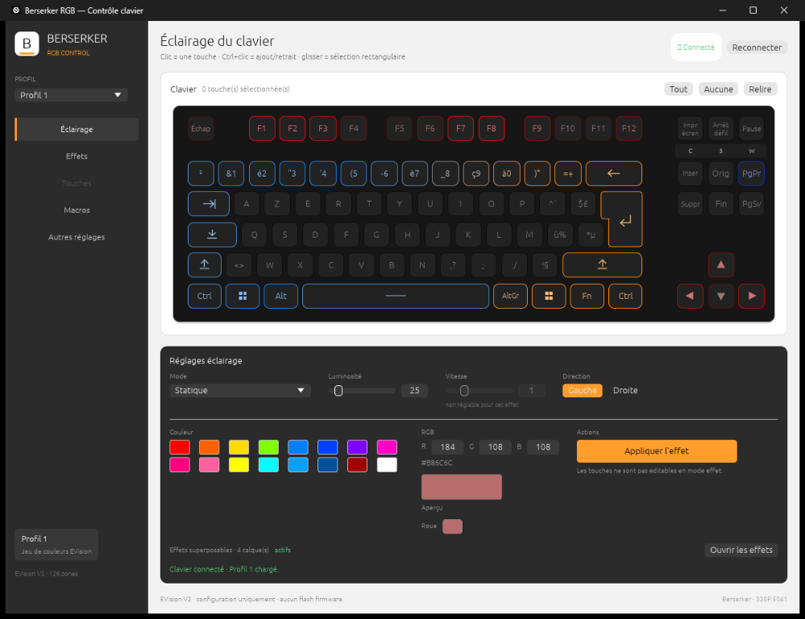
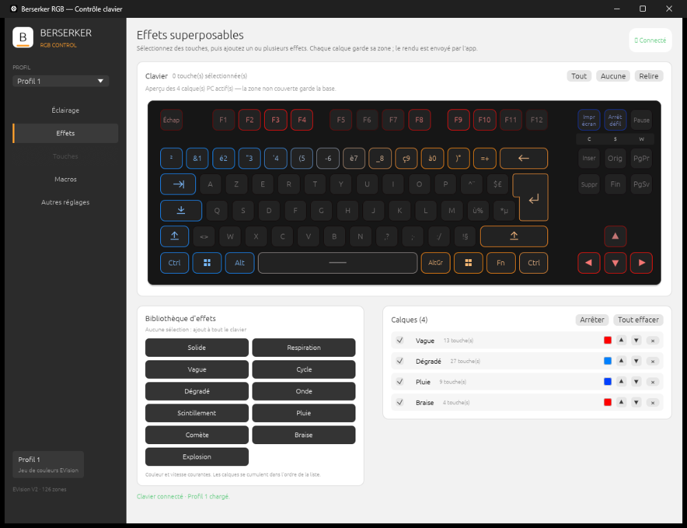

<div align="center">
  
  <h1>Berserker RGB</h1>
  <p><strong>Contrôle RGB per-touche et configuration du clavier Berserker BYGG.</strong></p>
  <p>
    
    
    
    
    
  </p>
  <p>
    <a href="../../releases/latest">Télécharger</a> ·
    <a href="docs/PROTOCOL.md">Protocole EVision V2</a> ·
    <a href="CHANGELOG.md">Changelog</a> ·
    <a href="LICENSE">Licence MIT</a>
  </p>
</div>

> **Statut : alpha (v1.3.4).** Application testée sur le clavier Berserker BYGG
> `320F:5041` (EVision V2, 126 zones LED) sous Windows 10/11 x86_64. Le binaire
> Linux x86_64 est fourni compilé ; valider l'accès hidraw et le rendu sur votre
> distribution.

## Présentation

**Berserker RGB** est une application de bureau écrite en Rust qui configure
l'éclairage et les réglages du clavier Berserker BYGG par USB HID. Elle permet
de composer des couleurs per-touche, de gérer 10 profils complets, d'empiler
plusieurs effets sur des zones choisies et d'ajuster les options matérielles du
clavier.

L'application envoie uniquement des commandes de **configuration** EVision V2.
Elle ne contient aucune commande de flash ou de bootloader : le firmware du
clavier reste intact.

## Fonctionnalités

### Éclairage per-touche

- Vue TKL AZERTY fidèle au clavier physique, avec la touche Entrée ISO en L.
- Sélection d'une touche, ajout/retrait avec `Ctrl+clic`, sélection
  rectangulaire par glisser.
- Peinture d'une couleur sur la sélection, extinction, peinture globale.
- Palette de 16 teintes et sélecteur de couleur libre **« Roue »**
  (teinte, saturation/valeur, saisie R/G/B).
- Aperçu du clavier et du mode d'effet en cours.

### Profils

- 10 profils complets : couleurs per-touche, mode, luminosité, vitesse,
  direction, fréquence USB, debounce, Mode Jeu, Mode flèche et Anti-ghosting.
- Profil actif mémorisé et restauré au démarrage.
- Sauvegarde/restauration manuelle, backup automatique avant écriture et
  annulation/rétablissement (`Ctrl+Z` / `Ctrl+Y`, 40 niveaux).

### Effets

- 12 effets firmware pilotables : Statique, Respiration, Vortex, Aura, Vagues,
  Scintillements, Mosaïques, Cascade, Oscillation, Pluie, Balayage, Radiation ;
  plus le mode **Personnalisé** pour les couleurs per-touche.
- 11 effets logiciels superposables : Solide, Respiration, Vague, Cycle,
  Dégradé, Onde, Scintillement, Pluie, Comète, Braise, Explosion.
- Jusqu'à **8 calques**, chacun limité à une sélection de touches, avec
  couleur, vitesse, sens, mélange (Ajouter/Remplacer), ordre et activation.
- Les calques sont enregistrés avec le profil et rejoués au démarrage.
- Fenêtre réduite ou masquée : un rendu d'arrière-plan continue d'envoyer les
  frames directes au clavier ; l'animation des calques ne s'arrête pas avec
  les passes graphiques.
- Application fermée : la dernière image est figée en couleurs per-touche ;
  les calques restent enregistrés et sont rejoués au lancement suivant.
- Vitesse réglable de 0 (lent) à 4 (rapide) ; désactivée pour les modes qui
  l'ignorent (Statique, Balayage, Radiation, Personnalisé).

### Réglages matériels

| Réglage | Valeurs |
| --- | --- |
| Fréquence USB | 1000 / 500 / 250 / 125 Hz |
| Debounce | 5 / 10 / 15 / 20 ms |
| Mode Jeu | verrouillage de la touche Windows |
| Mode flèche | WASD ↔ flèches |
| Anti-ghosting | appuis simultanés fiables |

Chaque écriture est suivie d'une relecture de contrôle. Un backup du bloc de
configuration est créé avant la première modification.

### Macros

- Bibliothèque des fichiers `.mac` présents sur le PC.
- Import dans le dossier de l'application et suppression.
- Aucune macro n'est envoyée au clavier : l'application ne contient pas de
  commande d'upload de macros.

### Détection multi-appareils

- Page **Claviers** : détection HID des appareils suivants :
  - Berserker BYGG TKL d'usine (EVision V2, `320F:5041`) ;
  - autre modèle EVision (`320F`, PID non répertorié) ;
  - bootloader ISP Sonix (`0C45`, PIDs SN32F2xx/SN34F2xx) ;
  - interface brute QMK/VIA d'un clavier reflashé (usage `FF60:0061`).
- Pour un clavier **QMK/VIA**, contrôle global RGB Matrix via le protocole
  VIA (canal 3) : effet, luminosité, vitesse, couleur, lecture et sauvegarde
  EEPROM. Les IDs d'effets sont ceux de QMK ; le per-key n'est pas exposé par
  le firmware.
- L'interface VIA est ouverte automatiquement au démarrage. Les réglages QMK
  se font dans la page **Éclairage**, avec la même disposition que l'EVision :
  liste d'effets avec ID brut, curseurs, palette, saisie RGB et roue.
- L'aperçu distingue les effets qui utilisent la couleur des animations
  arc-en-ciel (IDs 12-24). Choisir une couleur bascule automatiquement sur
  **Couleur unie** (ID 1) ; une saturation nulle correspond au blanc.
- Le firmware flashé expose 44 effets (IDs 0-43). Les IDs 40-43 sont des
  extensions propres au firmware, sans nom standard : l'ID brut reste
  modifiable. La sauvegarde EEPROM est envoyée sur le canal RGB Matrix (3)
  après chaque application et reste disponible manuellement.
- VID/PID, usage HID, nom produit, chemin et puce Sonix éventuelle sont
  affichés ; les informations sont copiables.
- L'édition RGB per-touche reste centrée sur le Berserker BYGG TKL EVision.
- Aucun flash n'est effectué par l'application. SonixFlasherC est un outil
  séparé fourni par le fabricant : ni inclus, ni lancé ici.

### Interface et tooling

- Interface native egui, une seule fenêtre, sans console.
- Windows : rendu Direct3D 12 (GPU ou WARP), CRT statique, aucun runtime à
  installer. Icône, version de fichier 1.3.4.0 et manifeste embarqués
  (PerMonitorV2, asInvoker, long paths).
- Linux : rendu OpenGL 2.0 via X11/XWayland.
- CLI de diagnostic et de configuration pour les scripts.

## Aperçu

<p align="center">
  
  
</p>

<p align="center">
  <em>Page Éclairage : palette, couleur libre « Roue », réglages du mode.</em><br>
  <em>Page Effets : 11 effets logiciels, calques par sélection de touches.</em>
</p>

## Compatibilité

| Plateforme | Binaire | Rendu |
| --- | --- | --- |
| Windows 10/11 x86_64 | `berserker-rgb.exe` autonome | Direct3D 12 (GPU ou WARP) |
| Linux x86_64 | AppImage ou `tar.gz` | X11/XWayland + OpenGL 2.0 |

Claviers pris en charge :

- **Berserker BYGG, USB `320F:5041`**, firmware EVision V2 : édition RGB
  per-touche, profils et effets superposables.
- **Berserker BYGG, USB `320F:5042`**, firmware QMK/VIA : éclairage RGB
  Matrix global (effet, couleur, luminosité, vitesse) dans la page Éclairage.

Les autres appareils EVision et les bootloaders Sonix sont détectés en lecture
seule.

## Téléchargement et lancement

Les binaires sont publiés dans l'onglet
[**Releases**](../../releases/latest) du dépôt.

### Windows

1. Télécharger `berserker-rgb.exe` (ou le paquet `.zip`).
2. Lancer l'exécutable. Une seule fenêtre s'ouvre, sans console.
3. Si le clavier n'est pas détecté, fermer tout autre logiciel RGB puis
   cliquer sur **Reconnecter**.

L'exécutable embarque une icône, une version et un manifeste, mais n'est pas
signé Authenticode : SmartScreen peut demander une confirmation au premier
lancement. La signature nécessite un certificat de signature de code ; voir
[docs/WINDOWS.md](docs/WINDOWS.md).

### Linux

Avec l'AppImage :

```bash
chmod +x Berserker-RGB-x86_64.AppImage
./Berserker-RGB-x86_64.AppImage
# si FUSE n'est pas disponible :
./Berserker-RGB-x86_64.AppImage --appimage-extract-and-run
```

Ou avec l'archive :

```bash
tar -xzf berserker-rgb-linux-x86_64.tar.gz
./run-berserker-rgb.sh
```

Accès à `/dev/hidraw` (une fois). La règle est fournie dans
[`packaging/90-berserker-rgb.rules`](packaging/90-berserker-rgb.rules) et dans
l'archive Linux :

```bash
sudo cp 90-berserker-rgb.rules /etc/udev/rules.d/
# la règle fournie couvre 320F:5041 (EVision) et 320F:5042 (QMK/VIA)
sudo udevadm control --reload-rules
sudo udevadm trigger
# débrancher puis rebrancher le clavier
```

## Prise en main

1. Choisir un profil dans la liste de gauche.
2. Sélectionner des touches dans l'aperçu du clavier.
3. Choisir une couleur dans la palette ou via **Roue**, puis
   **Peindre la sélection**.
4. Pour empiler des effets : ouvrir **Effets**, sélectionner des touches, puis
   cliquer un effet dans la bibliothèque. Le calque est créé avec la sélection
   courante (ou tout le clavier si aucune touche n'est sélectionnée).
5. Ajuster couleur, vitesse, sens et mélange dans l'éditeur de calque.
6. Régler les options matérielles dans **Autres réglages**.

## Données locales

Windows :

```text
%LOCALAPPDATA%\BerserkerRGB\
  profiles\profil_N.bin       couleurs per-touche (126 × 3 octets)
  profiles\profil_N.state     état complet du profil
  profiles\profil_N.layers    calques d'effets PC
  profiles\actif.cfg          profil actif
  backups\                    sauvegardes manuelles et automatiques
  berserker-rgb.log           journal de diagnostic
```

Linux :

```text
${XDG_DATA_HOME:-~/.local/share}/berserker-rgb/
  berserker-rgb.log           journal de diagnostic
```

Aucune donnée n'est envoyée sur le réseau.

## Ligne de commande

```text
berserker-rgb --caps
berserker-rgb --config
berserker-rgb --map
berserker-rgb --get-system
berserker-rgb --set-system <freq 0-3> <debounce 0-3>
berserker-rgb --set-flags <mode_jeu 0|1> <fleche 0|1> <anti_ghosting 0|1>
berserker-rgb --profile-switch <0-9>
berserker-rgb --backup-all <dossier>
berserker-rgb --custom-read <jeu 0-9> <fichier>
berserker-rgb --custom-write <jeu 0-9> <fichier>
berserker-rgb --direct-test RRGGBB [secondes]
berserker-rgb --dump-config <offset> <taille>
berserker-rgb --qmk-state
berserker-rgb --qmk-solid RRGGBB
berserker-rgb --qmk-set <effet> <luminosité> <vitesse> <teinte> <saturation>
berserker-rgb --qmk-save
```

Les commandes `--qmk-*` pilotent l'éclairage RGB Matrix du firmware QMK/VIA
(canal 3) et servent au diagnostic ; elles ne flashent rien. Les commandes
`--custom-read` / `--custom-write` manipulent les jeux de couleurs EVision
(10 jeux de 378 octets). Le firmware affiche le jeu 0 ;
l'application y recopie le profil sélectionné. Pour `--profile-switch`,
l'index `0` correspond au profil 1 et l'index `9` au profil 10.

## Compilation

Prérequis : **Rust stable 1.95+** (eframe/egui 0.37).

```bash
git clone https://github.com/<votre-compte>/berserker-rgb.git
cd berserker-rgb

cargo test --release
cargo build --release
```

### Windows

- Toolchain MSVC (`x86_64-pc-windows-msvc`).
- Le fichier `.cargo/config.toml` active la CRT statique : l'exécutable ne
  dépend d'aucune DLL tierce.
- Sortie : `target\release\berserker-rgb.exe`.

### Linux

- Serveur X11 ou XWayland et pilotes OpenGL 2.0 (Mesa).
- Bibliothèques de développement X11/XCB et OpenGL selon la distribution.
- Sortie : `target/release/berserker-rgb`.

## Structure du projet

```text
src/main.rs        interface egui, profils, effets, macros, CLI
src/devices.rs     détection EVision / Sonix ISP / QMK-VIA
src/qmk.rs         client VIA RGB Matrix (éclairage global QMK)
src/protocol.rs    protocole EVision V2 (configuration et frames directes)
src/layout.rs      disposition TKL AZERTY et mapping des 126 zones
src/linux_hid.rs   accès hidraw sous Linux
build.rs           ressources Windows (icône, version, manifeste)
resources/         icône .ico et manifeste de l'exe Windows
docs/PROTOCOL.md   notes techniques du protocole et des formats
docs/WINDOWS.md    métadonnées et signature Authenticode
packaging/         règle udev et lanceur Linux
```

## Sécurité

- Aucune commande de flash ou de bootloader n'est implémentée.
- Seules les commandes EVision V2 de configuration sont envoyées.
- Les écritures sont relues pour vérification.
- Le firmware du clavier reste inchangé.

## Limites connues

- Application en alpha ; le clavier cible de l'édition RGB est le `320F:5041`.
- Les autres modèles EVision sont détectés en lecture seule ; leurs
  protocoles et layouts RGB ne sont pas implémentés.
- Les claviers QMK/VIA exposent un contrôle RGB Matrix global, pas le
  per-key ; les IDs d'effets peuvent varier selon la compilation du firmware.
- Effets QMK sans couleur : Désactivé (0) et les animations arc-en-ciel
  (12-24) ignorent la teinte et la saturation. L'interface le signale et
  bascule sur **Couleur unie** (1) dès qu'une couleur est choisie. Le noir
  sélectionne **Désactivé**, la couleur VIA n'ayant pas de composante de
  valeur.
- En mode QMK/VIA, les profils EVision et les calques PC ne sont pas
  disponibles : le firmware ne gère que l'éclairage global.
- Aucun flash de firmware n'est proposé. SonixFlasherC n'est ni inclus ni
  lancé par l'application.
- Les calques d'effets sont animés par l'application sur le PC. En fenêtre
  réduite, un thread d'arrière-plan maintient l'animation ; à la fermeture, la
  dernière image est figée en couleurs per-touche et le rendu animé reprend au
  lancement suivant.
- En arrière-plan, les calques continuent d'animer ; une éventuelle base
  d'effet firmware est figée pendant la réduction.
- Les effets réactifs aux frappes ne sont pas disponibles : l'application ne
  capture pas les touches au niveau système.
- Les macros sont une bibliothèque de fichiers ; il n'y a pas d'upload vers le
  clavier.
- Le binaire Linux est fourni compilé ; valider le rendu et l'accès hidraw sur
  votre distribution.

## Licence

Distribué sous licence [MIT](LICENSE).

Projet indépendant, non affilié au fabricant du clavier.

---

## English summary

**Berserker RGB** is a native Rust desktop app for the Berserker BYGG keyboard
(USB `320F:5041`, EVision V2, 126 LED zones). It provides per-key color
editing, 10 full profiles, 12 firmware effects plus a custom mode, up to 8
PC-side stacked effects over selected keys, polling, debounce, game mode,
arrow mode and anti-ghosting settings, a local macro file library, undo/redo
and CLI diagnostics. A **Devices** page detects factory EVision, other EVision
models, Sonix ISP bootloaders and QMK/VIA interfaces. QMK keyboards get global
RGB Matrix controls through the VIA protocol (effect, brightness, speed, color
and EEPROM save) inside the Lighting page, with the same layout as EVision.
The VIA interface is opened automatically, rainbow effects (IDs 12-24) are
previewed as such, and picking a color switches to Solid Color (ID 1). The
flashed firmware exposes 44 effects (IDs 0-43); IDs 40-43 are unlabelled
firmware extensions. EEPROM save is sent on RGB Matrix channel 3 after each
apply. Per-key editing remains EVision-only.

Windows builds use Direct3D 12 (GPU or WARP) with a static CRT and no external
DLLs. Linux builds use X11/XWayland and OpenGL 2.0. The app only sends EVision
V2 configuration commands — it never flashes or modifies the keyboard firmware.
SonixFlasherC is a separate manufacturer tool and is not included or launched
by this app.

Download binaries from the [Releases](../../releases/latest) page. Build with
Rust 1.95+ using `cargo build --release`. MIT licensed.
